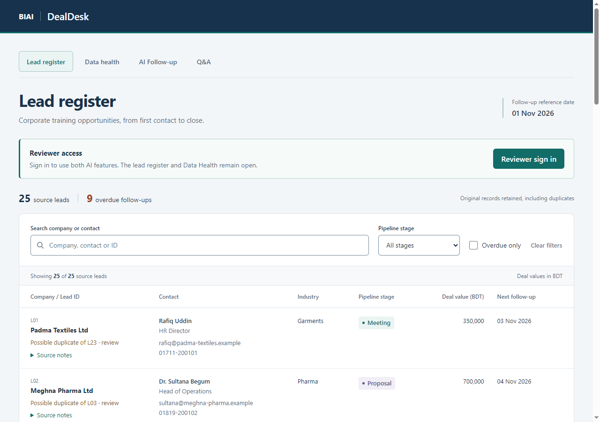
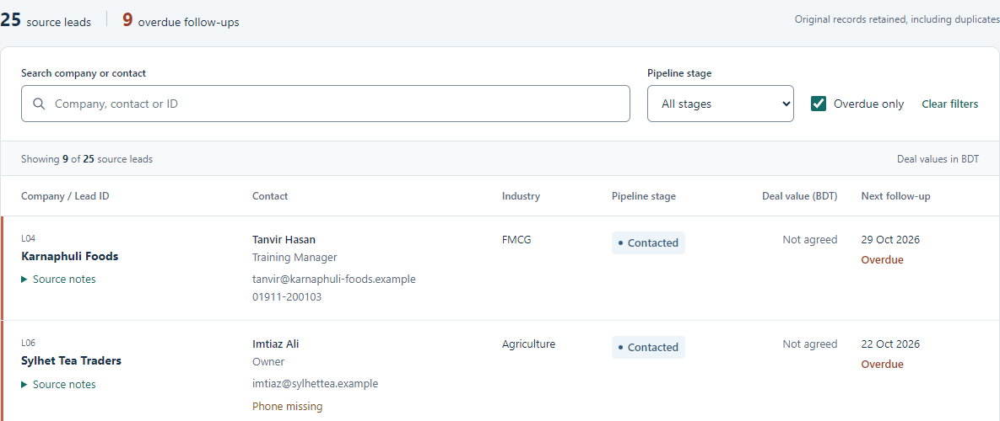
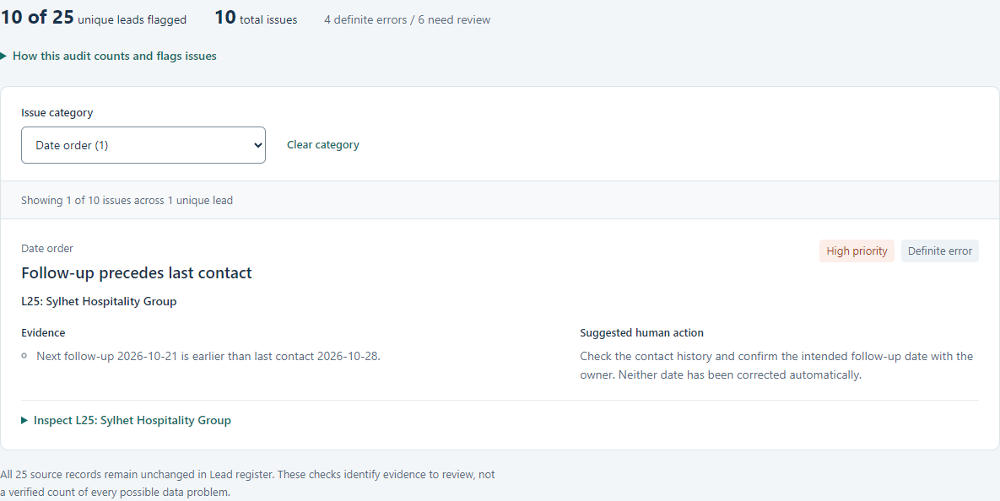
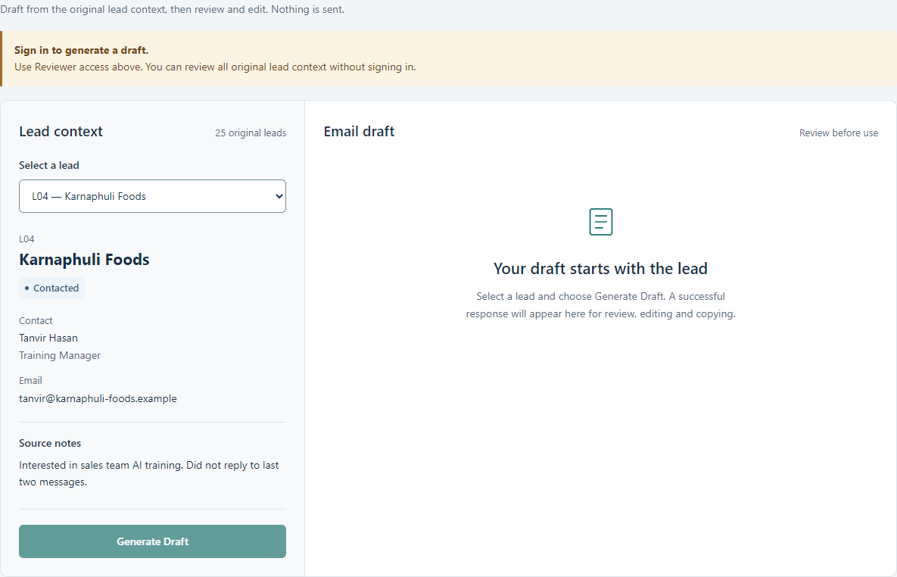
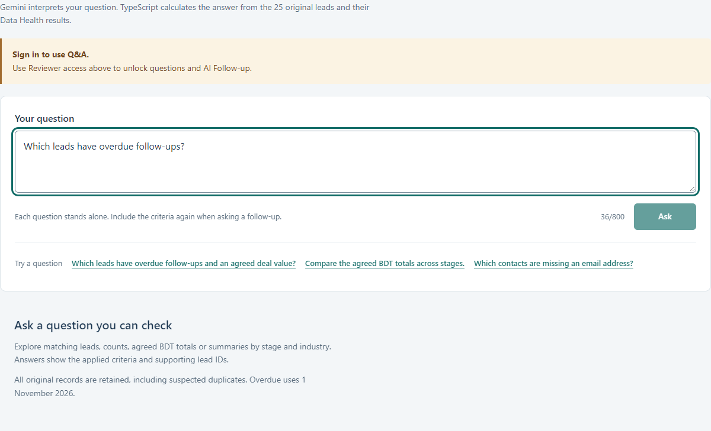
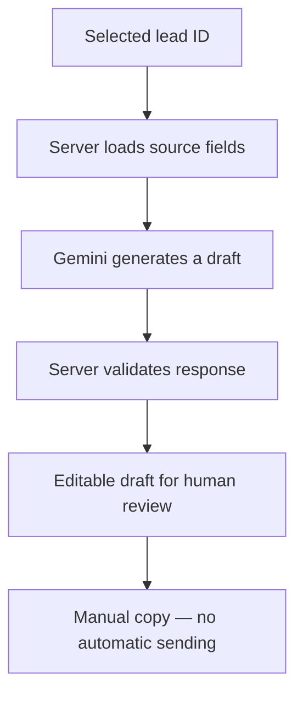
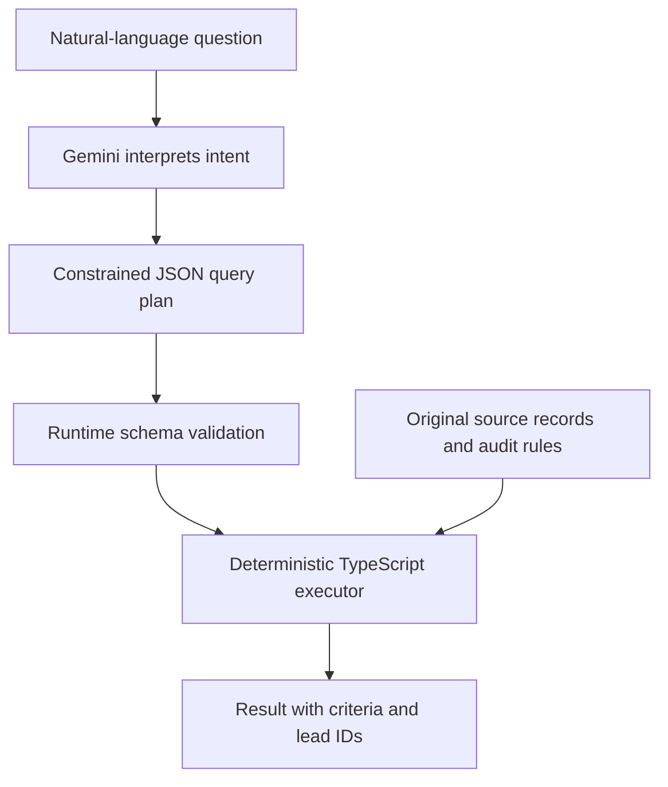
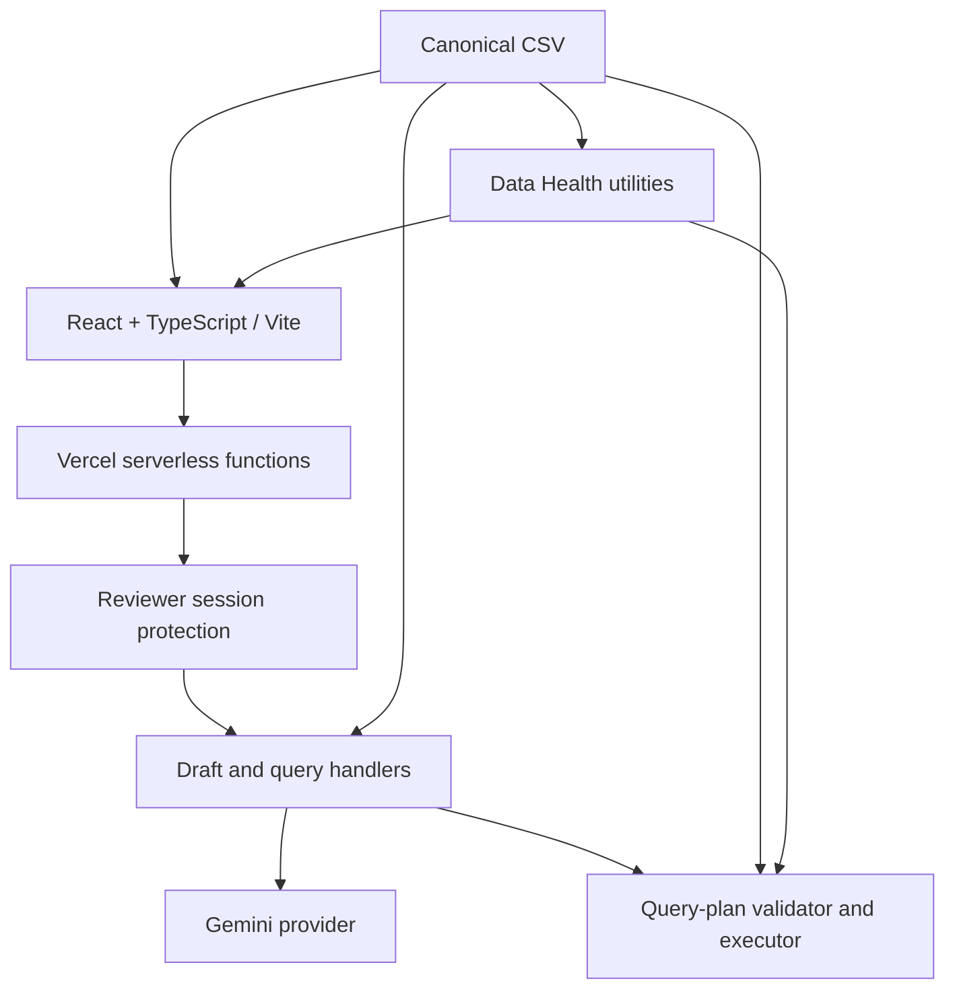

# BIAI DealDesk

**Know which lead needs attention—and see the evidence behind the next step.**

An AI-assisted corporate leads pipeline that turns 25 supplied records into a searchable register, a data-quality review queue and two Gemini-powered workflows. Draft a considered follow-up or ask a business question, with original records and human review kept in view.


**[Live Application](https://biai-dealdesk.vercel.app/)** · **[Watch Demo](https://www.loom.com/share/9f2b772b2a104c6f86bbaf0505659927)** · [Feature Walkthrough](#feature-walkthrough) · [Architecture](#architecture) · [Local Setup](#local-setup)

[](docs/readme-assets/hero.png)

*Actual deployed interface. Public records are open; AI actions require reviewer sign-in. Select any screenshot to inspect it at full resolution.*

[Discover the problem](#the-business-problem) → [See the features](#feature-walkthrough) → [Explore a workflow](#guided-walkthrough) → [Understand the AI](#how-the-ai-works) → [Verify the evidence](#testing-and-verification) → [Try DealDesk](#try-the-application)

## The business problem

A spreadsheet can hold a pipeline without making the next action clear. An employee still has to find overdue follow-ups, reconcile conflicting notes, check missing contacts and decide whether repeated records inflate deal values.

DealDesk brings those decisions together: filter the leads that need attention, inspect the evidence behind a warning, then prepare a message or query the recorded pipeline. It preserves the supplied data so a reviewer can trace each result back to a lead ID.

## Verified project metrics

| **25** | **9** | **10** | **2** |
| :--- | :--- | :--- | :--- |
| Original lead records | Overdue follow-ups | Unique flagged leads | Gemini-powered workflows |

Computed against the [canonical CSV](src/data/corporate-leads.csv) and [data utilities](src/data/leads.ts). Overdue means a recorded follow-up **strictly before 1 November 2026**, the fixed assessment reference date—not the reader's current date. Ten flagged leads span ten issues; those totals happen to be equal.

These are fictional source records and rule-based findings, not confirmed customer facts, verified revenue or a measured data-cleaning accuracy score.

## Feature walkthrough

[Lead register](#lead-register) · [Data health](#data-health) · [AI Follow-up](#ai-follow-up) · [Q&A](#qa)

### Lead register

**Find the follow-up that needs attention.**

[](docs/readme-assets/overdue-filter.png)

Scanning a spreadsheet makes it easy to miss a date or lose its context. Search by company, contact or ID; combine the search with **Pipeline stage** and **Overdue only**; expand **Source notes** without leaving the register.

**Try L04:** Karnaphuli Foods has a follow-up on **29 October 2026**, so it is overdue. Its zero source value displays as **Not agreed**. The employee sees both the next-action signal and the limits of the commercial information.

<details>
<summary>Explore overdue detection and the seven stages</summary>

The five active stages are **New → Contacted → Meeting → Proposal → Invoice sent**. **Paid** and **Lost** are separate end stages. All seven appear in the filter.

The nine overdue IDs are **L04, L06, L10, L13, L15, L19, L20, L22 and L25**. L09 is due on the reference date and is not overdue. Missing dates do not qualify; the rule does not silently exclude end stages. L25 remains overdue even though its date order also needs correction.

Search, stage and overdue filters intersect. The source total remains 25, and clearing filters restores the original order. See [filtering and date rules](src/data/leads.ts) and [their tests](tests/leads.test.mjs).

</details>

### Data health

**Review the evidence before changing the record.**

[](docs/readme-assets/data-health.png)

Missing contacts, repeated entries and contradictory fields can lead to the wrong outreach or misleading totals. This view groups findings by **Issue category**, shows severity separately from certainty, and lets the employee inspect the original fields.

**Inspect L25:** its next follow-up is **21 October**, but its last contact is **28 October**. DealDesk flags a definite date-order error and asks for human verification; it does not invent a replacement date.

<details>
<summary>Explore the ten issues and how flagged leads are counted</summary>

| Category | Issues | Affected lead IDs |
| --- | ---: | --- |
| Missing contact | 3 | L06; L24 has two missing fields |
| Possible duplicate | 2 pairs | L01/L23; L02/L03 |
| Date order | 1 | L25 |
| Field / note conflict | 3 | L06, L12, L20 |
| Email verification | 1 | L18 |

There are **four definite errors and six review candidates** under the implemented rules. Each affected lead counts once, including both IDs in a duplicate pair: **L01, L02, L03, L06, L12, L18, L20, L23, L24, L25**.

Note checks recognize narrow, explicit statements in this dataset; they are not general AI interpretation. Missing follow-up dates and email deliverability are outside the audit. See [audit rules](src/data/health.ts), [negative-case tests](tests/health.test.mjs) and [trust decisions](#trust-and-data-quality).

</details>

### AI Follow-up

**Start with the lead's context. Keep control of the message.**

[](docs/readme-assets/ai-follow-up.png)

*Signed-out production state; no generated or mocked email is shown.*

Writing from memory can miss a lead's interests or contact history. **Select a lead** loads original context and any Data Health warnings. After reviewer sign-in, **Generate Draft** requests a short English email with editable **Subject** and **Body**, then **Copy Email** supports manual use.

**L04's context:** Tanvir Hasan is interested in sales-team AI training and has not replied to the last two messages. Those notes inform the request; the employee must check wording and claims before copying the draft. Nothing is automatically sent.

<details>
<summary>Explore what Gemini receives and what validation establishes</summary>

The browser sends only a lead ID. The server loads the source record and supplies nonempty company, contact name, contact role, stage and notes. Recipient email/phone, dates, values and other leads are not attached to the draft prompt.

The response must satisfy subject/body shape and size limits. The UI validates it again and identifies which fields were supplied. This provenance does not prove that every sentence is accurate. Replacement requires confirmation and retains the previous draft if generation fails.

See the [email flow](#personalized-email-flow), [server handler](server/draft.ts) and [draft editor](src/AiFollowUp.tsx).

</details>

### Q&A

**Ask naturally. Check the calculation.**

[](docs/readme-assets/qa-interface.png)

*Signed-out production state; the question is entered but has not been submitted.*

Business questions often combine criteria that a simple stage filter cannot express. Gemini interprets the question into a constrained plan; TypeScript returns matching records, counts, agreed BDT sums or groups by stage/industry, together with criteria and source IDs.

**Checkable example:** “What is the total agreed value in Proposal stage?” should select **L02, L03 and L14**, totaling **BDT 1,620,000** from the original rows. L02/L03 are duplicate candidates, so the result must be read with the duplicate-value warning. This is a verified source calculation, not a captured live Gemini answer or collected revenue.

<details>
<summary>Explore supported questions and interpretation limits</summary>

Supported operations are `list`, `count`, `sum` and `group`, with bounded filters and sorting. Ask for overdue leads with an agreed value, missing email addresses, or totals by stage.

Each question stands alone. Forecasts, averages, unrecorded payments, arbitrary interpretation of notes and deduplicated company totals are unsupported. A schema-valid interpretation can still misunderstand the question: review **How this was calculated** and the matching source records.

See the [Q&A flow](#question-and-answer-flow), [runtime validator](server/query-plan.ts), [deterministic executor](server/query-engine.ts) and [calculation tests](tests/query-engine.test.mjs).

</details>

## Guided walkthrough

Follow the first four steps without signing in. AI submissions require the privately supplied reviewer password and consume provider quota.

1. **[Open the live application](https://biai-dealdesk.vercel.app/).** In **Lead register**, confirm **Showing 25 of 25 source leads**.
2. **Select Overdue only.** Expect nine records. Search `L04` in **Search company or contact** to narrow the list to Karnaphuli Foods.
3. **Expand Source notes** for L04. Read the training interest and unanswered-message context, then choose **Clear filters**.
4. **Open Data health.** Set **Issue category** to **Date order (1)** and expand **Inspect L25: Sylhet Hospitality Group**. Compare the dates with the warning.
5. **Choose Reviewer sign in.** Enter the privately shared password, then **Sign in**. No username is required. Wait for session confirmation.
6. **Open AI Follow-up.** In **Select a lead**, choose **L04 — Karnaphuli Foods**, then **Generate Draft**. On success, review/edit **Subject** and **Body** against the notes before using **Copy Email**.
7. **Open Q&A.** Enter `Which leads have overdue follow-ups?` in **Your question**, then choose **Ask**.
8. **Inspect the answer.** For an overdue-only interpretation, expect the nine IDs listed [above](#lead-register). Review **How this was calculated** and **Inspect 9 matching source records**. If criteria differ, revise the question; a valid plan is not proof of correct intent.

If Gemini returns an error or quota limit, the app reports it without inventing a draft or substitute answer. Finish with **Sign out** when using a shared device.

## How the AI works

### Personalized email flow



Only the server calls Gemini. Draft validation checks structure and bounds; the user checks meaning. There is no email-delivery integration.

### Question and answer flow



**Gemini interprets the question. TypeScript calculates the answer.**

The question, schema and business rules go to Gemini; CSV rows are not attached to the query prompt. The server rejects unsupported properties and operations, then calculates from the canonical records. No generated SQL, arbitrary code execution or model-supplied numeric answer is trusted.

> [!IMPORTANT]
> Deterministic execution makes a validated plan reproducible. It does not guarantee that Gemini chose the intended criteria or that the supplied business data is correct.

## Trust and data quality

| Decision | What it protects |
| --- | --- |
| Preserve all 25 original records | No silent corrections, deletions or merges; IDs remain inspectable. The app CSV matches the supplied file byte for byte. |
| Attach evidence to flags | Missing fields and reversed dates are distinguished from conflicts needing review. Severity is priority, not certainty. |
| Retain possible duplicates | Shared contacts require investigation. Contributing duplicate pairs trigger value warnings. |
| Keep empty values distinct from zero | The parser retains `null` versus `0`; both display as **Not agreed**. Sums use positive recorded amounts, not estimates. |
| Fix the overdue reference date | Reproducible assessment results, independent of the machine clock. |
| Require review before use | Editable drafts, manual copying, visible query criteria and source IDs. |
| Validate at runtime | Plans must fit an allowlisted schema before execution; malformed output produces a safe error. |
| Protect provider access | Server-only credentials, production reviewer sessions, same-origin checks, bounded responses and limited requests. |

**A conflict worth investigating:** L06 has an email in its structured field, but its note says no phone or email is on file. Its phone really is empty. The audit records **one definite missing-phone error and one field/note conflict**, while counting L06 once. It neither erases the email nor assumes the note is current.

## Architecture



<details>
<summary>Frontend architecture</summary>

[App.tsx](src/App.tsx) coordinates four views without a routing dependency: [Lead register](src/App.tsx), [Data health](src/DataHealth.tsx), [AI Follow-up](src/AiFollowUp.tsx) and [Q&A](src/AskPipeline.tsx). The register uses a desktop table and labeled mobile cards. Filter state survives view changes; reload resets it. AI workspaces live in memory and clear on sign-out or session invalidation.

Vite bundles the source CSV through a raw import. The [parser](src/data/leads.ts) handles quoted fields, validates dates/stages and preserves values.

</details>

<details>
<summary>Backend and AI integration</summary>

Five serverless entrypoints expose [draft](api/ai/draft.ts), [query](api/ai/query.ts), [login](api/auth/login.ts), [session](api/auth/session.ts) and [logout](api/auth/logout.ts). [Vercel configuration](vercel.json) includes the CSV; [root TypeScript settings](tsconfig.json) rewrite emitted imports to JavaScript.

[Draft](server/draft.ts) and [query](server/query.ts) use native server-side fetch. The checked-in default is `gemini-3.5-flash-lite`; deployment can select a supported server-only override. The deployed override was not inspected. No automatic model fallback or retry occurs.

Local Vite uses the [same core handlers](server/vite-ai.ts). The [packaging report](docs/TASK-009-VERCEL-PACKAGING.md) explains the JavaScript-only function checks and their limits.

</details>

<details>
<summary>Query execution and safety</summary>

The [contract](src/ai/query-contract.ts), [runtime validator](server/query-plan.ts) and [executor](server/query-engine.ts) separate intent from calculation. Plans support up to four OR groups of six AND predicates, typed comparisons and bounded result limits. Value sums use integer cents before conversion to BDT; issue counts deduplicate issue IDs and flagged-lead counts deduplicate lead IDs.

Both Gemini handlers bound input/output and provider timeouts, reject unsafe response shapes and expose fixed errors. Each independently limits work to one in-flight request, five attempts/minute and 30/hour per instance. These are not global spending controls. See [query documentation](docs/AI-QUERY.md); its dated smoke results describe historical runs.

</details>

<details>
<summary>Authentication and security</summary>

[Reviewer authentication](server/reviewer-auth.ts) and [session validation](server/reviewer-session.ts) protect both AI endpoints. Production cookies are signed, origin-bound, **HttpOnly**, **Secure**, **SameSite=Strict** and expire after two hours. Exact origin checks protect cookie-authenticated state changes; invalid authorization fails closed.

The browser never receives a Gemini key or server bearer credential. A separate trusted bearer path exists for server/CLI use. The [reviewer access guide](docs/REVIEWER-ACCESS.md) documents configuration, rotation and local development without working credentials.

</details>

<details>
<summary>Data model and limitations</summary>

[Source loading](server/source-leads.ts) reads and freezes the canonical records. [Data Health](src/data/health.ts) derives issues without modifying them. No database, editing workflow, contact enrichment or CRM synchronization is implemented.

The CSV contains 12 positive values and 13 zeros, with no blank value cells; parser tests cover empty-value handling. Duplicate candidates remain separate. L12's **Paid** stage conflicts with its partial-payment note, so recorded deal values must not be presented as confirmed receipts.

</details>

## Try the application

**[Launch BIAI DealDesk](https://biai-dealdesk.vercel.app/)**

**Lead register** and **Data health** are publicly accessible. AI views can be explored while signed out, but **Generate Draft** and **Ask** require reviewer sign-in in production. The shared password is supplied privately to intended evaluators; no username is required.

Use the HTTPS address and allow first-party cookies. Gemini requests depend on provider availability and rate limits. See [reviewer access](docs/REVIEWER-ACCESS.md) for configuration and [verification](#testing-and-verification) for what has actually been checked.

## Local setup

Use **Node.js 22.18.0 or newer within the Node 22 line** and **npm 10**; this review used Node 22.18.0 / npm 10.9.3. Tests execute TypeScript directly through Node. The project does not declare package-level `engines`; this is the verified environment.

```powershell
git clone https://github.com/Jabir281/biai-dealdesk.git
Set-Location .\biai-dealdesk
npm.cmd ci
Copy-Item .env.example .env.local
npm.cmd run dev
```

The cloned repository root contains `package.json`; there is no second `app` directory to enter. In the supplied workspace, that same root is **`D:\BIAI\app`**. If `.env.local` already exists, retain it instead of copying over it. Open the localhost URL printed by Vite.

Before using AI, privately fill the blank `GEMINI_API_KEY` setting in `.env.local` using [.env.example](.env.example) as the template, then restart Vite. Public data views work without a key. Keep credentials server-side; never use a `VITE_` prefix. Reviewer password/signing-secret settings are needed for login testing and production browser access; requirements are in the [access guide](docs/REVIEWER-ACCESS.md).

Local AI access trusts the actual loopback connection after socket, Host and Origin checks and does not require reviewer login. Keep the development server local; do not expose it through a public tunnel. `npm.cmd run preview` serves static output, not the local AI middleware.

In a second PowerShell terminal at the same root:

```powershell
npm.cmd test
npm.cmd run build
npm.cmd run lint
node scripts/check-client-secrets.mjs
```

These checks do not make live Gemini requests. The separate `smoke:ai` and `smoke:query` scripts do; they are not routine setup or health checks.

## Testing and verification

Reviewed on **5 November 2026**, against local source revision **`c24959b`**. Fresh results are distinguished from earlier recorded passes.

| Check | Purpose | Evidence and boundary |
| --- | --- | --- |
| Automated tests | Data rules, clients, AI contracts, authorization and packaging | Fresh `npm.cmd test`: **76 passed / 77 total**. One packaging test hit filesystem `EPERM` creating its scratch directory. The latest documented full pass is **77/77** in [Task 009](docs/TASK-009-VERCEL-PACKAGING.md). |
| Build | Type checking, bundle and five isolated function runtimes | Fresh build reached Vite after TypeScript checking, then hit `EPERM` replacing an existing `dist` asset. Full build/runtime success is documented in [Task 009](docs/TASK-009-VERCEL-PACKAGING.md), not claimed for this rerun. |
| Lint | Static code quality | Fresh `npm.cmd run lint`: **passed**. |
| Secret check | Check built files for server credential names and configured values | Fresh [client-secret scan](scripts/check-client-secrets.mjs): **passed**, three existing client files. Build was blocked, so this is not a newly rebuilt bundle. |
| Production browser | Public workflow and access boundaries | Fresh Playwright inspection: 25 rows, exact nine overdue IDs, ten health issues, L25 evidence, L04 context, both AI actions disabled while signed out, session endpoint HTTP 200. No horizontal overflow in four inspected states at 390px. |
| Authenticated browser | Cookies and protected workflows | [Task 008](docs/TASK-008-VERIFICATION.md) records **48 checks** over isolated local HTTPS at desktop/mobile sizes, with real test cookies and **mocked Gemini**. Not a fresh production login test. |
| Source preservation | Independently check calculations and unchanged data | Python CSV calculation confirmed 25 rows, nine overdue IDs and BDT 1,620,000 in Proposal. Original/app-copy SHA-256 match; [data](tests/leads.test.mjs) and [audit tests](tests/health.test.mjs) cover the rules. |
| README rendering | Navigation, assets and native interactions | GitHub Markdown API rendered successfully; local links/images and heading anchors validated. Twelve details sections and three Mermaid diagrams checked; desktop/mobile light/dark previews reviewed. |
| Live Gemini | Real provider behavior | The applicant manually verified both Gemini email drafting and Q&A on the deployed Vercel application. No additional live Gemini calls were made during README preparation. Automated provider tests use mocks, and live service availability may vary. |

Mocks verify contracts, execution and failure handling—not general natural-language accuracy, current quota or output quality. Screenshots are fresh, signed-out captures of the actual deployment; none contains a mocked result, password form or generated email. The exact deployed commit was not independently identified.

<details>
<summary>Reproduce the review and interpret the filesystem blockers</summary>

The fresh test failure was `EPERM` from `mkdtemp` under `node_modules/.cache/server-runtime-*`. The build failure was `EPERM` from unlinking `dist/assets/index-9FZlIPyK.css`. These are observed filesystem failures, not failing business-calculation assertions. No permissions, application code or test expectations were changed to bypass them. Rerun the commands in a writable checkout to establish a new complete pass.

The original and app-copy CSV SHA-256 is:

```text
e2528aa4cc87eb5b718fc532912db8a0bddc714a736f0c31a80ffacaf86a66e1
```

This README uses [GitHub section links and callouts](https://docs.github.com/en/get-started/writing-on-github/getting-started-with-writing-and-formatting-on-github/basic-writing-and-formatting-syntax), [native collapsed sections](https://docs.github.com/en/get-started/writing-on-github/working-with-advanced-formatting/organizing-information-with-collapsed-sections) and [Mermaid fences](https://docs.github.com/en/get-started/writing-on-github/working-with-advanced-formatting/creating-diagrams). All visual assets are repository-local; no scripts, iframes or remote badge services are required.

</details>

## Limitations and roadmap

<details>
<summary>Current limitations — implemented scope and honest boundaries</summary>

- **Assessment data:** 25 fictional records and a fixed overdue date, not a live sales pipeline.
- **Human interpretation:** ambiguous notes, contact quality and duplicate candidates require review. Totals may include repeated opportunities.
- **Bounded questions:** supported operations only; no forecasts, arbitrary aggregate arithmetic or conversational memory. Gemini can misinterpret intent.
- **Provider dependence:** availability, quotas and output quality vary. No automatic retries or fabricated fallback.
- **Stateless reviewer sessions:** shared identity, not individual accounts. Logout clears the current cookie but cannot revoke a copied session elsewhere before expiry; secret rotation invalidates outstanding sessions.
- **Per-instance controls:** cold starts reset counters; limits are not distributed across Vercel instances or a global spend cap.
- **No production CRM integration:** no persistent edits, audit trail, automated sending, payment verification or customer-system synchronization.

</details>

<details>
<summary>Potential improvements — not implemented features</summary>

- Persistent database with approved record editing, original-value history and an audit trail.
- Individual accounts, role-based access and revocable sessions.
- Distributed rate controls and provider-budget monitoring.
- Optional, explicitly approved CRM/email integrations with review before outbound actions.
- Expanded analytical operations backed by interpretation evaluations and deterministic tests.

</details>

## For reviewers: what this project demonstrates

- **End-to-end delivery:** four coherent views, shared server handlers and a deployed Vercel interface.
- **Business understanding:** follow-up triage, contact gaps and value ambiguity grounded in supplied records.
- **Meaningful Gemini integration:** personalized drafting and free-form intent interpretation with distinct responsibilities.
- **Grounded calculations:** validated plans, deterministic results, visible criteria and supporting IDs.
- **Backend security judgment:** server-held credentials, protected AI actions and explicit session/rate-limit boundaries.
- **Transparent data quality:** evidence, uncertainty and original records stay visible together.
- **Verification discipline:** automated tests and browser evidence, distinguishing mocks, historical passes and current checks.
- **Honest scope:** a focused assessment application with documented limits and unimplemented next steps.

---

[Live application](https://biai-dealdesk.vercel.app/) · [GitHub repository](https://github.com/Jabir281/biai-dealdesk) · [Back to top](#biai-dealdesk)

Developed for **BIAI's AI Internship Round 2, Task 2: Corporate Leads Pipeline**. All lead data is fictional and supplied for assessment. This project does not imply official BIAI endorsement.
